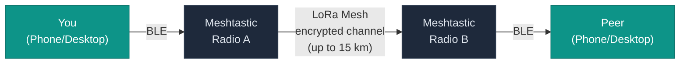
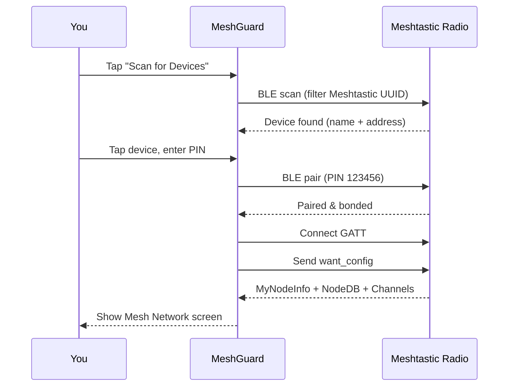
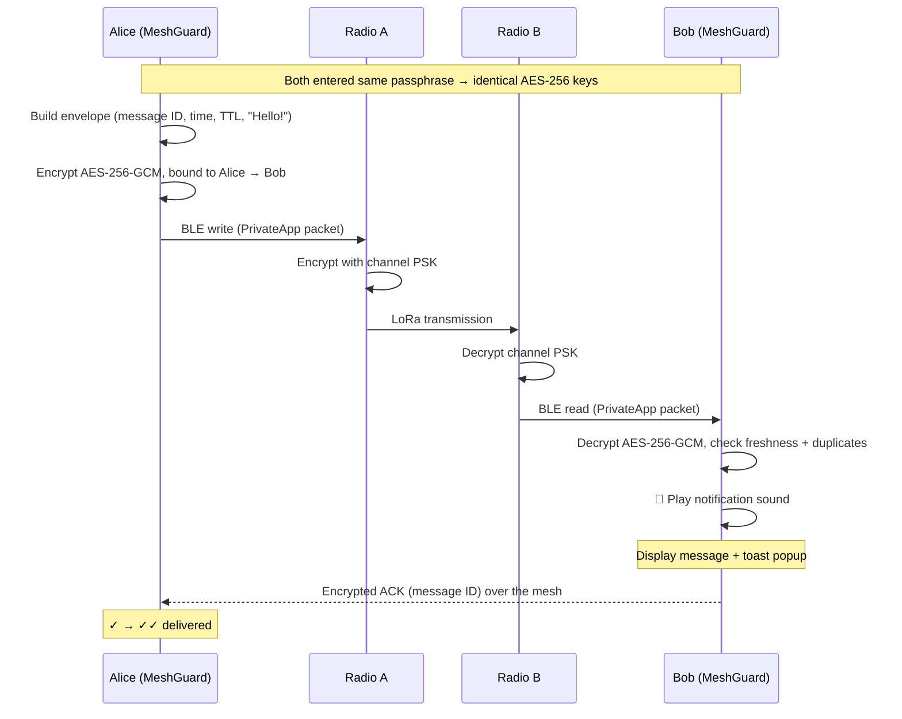
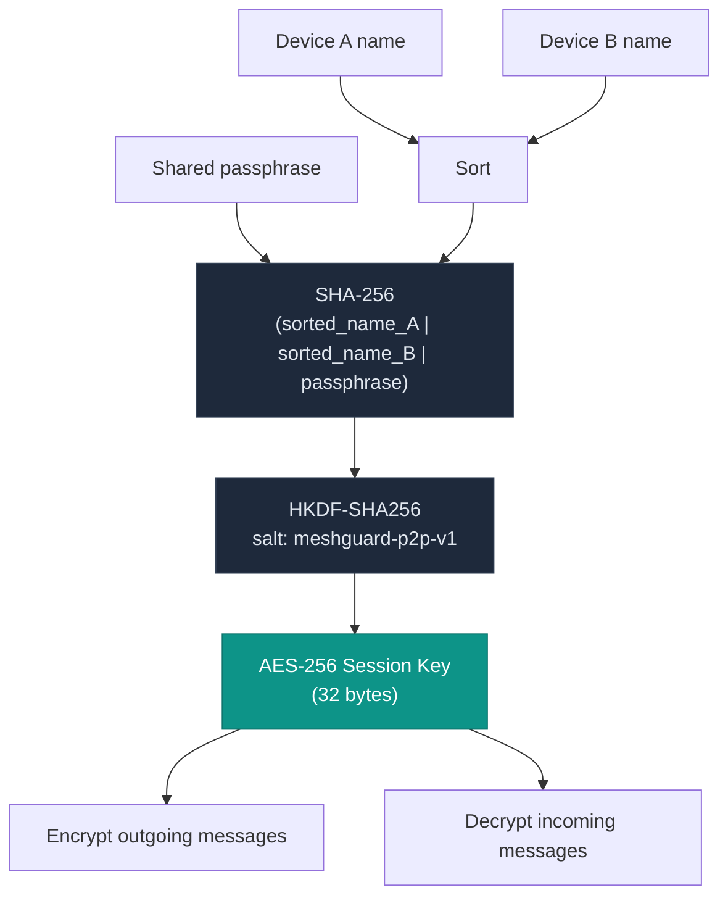
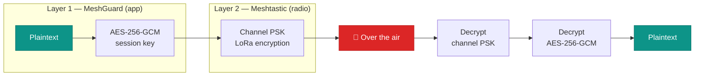
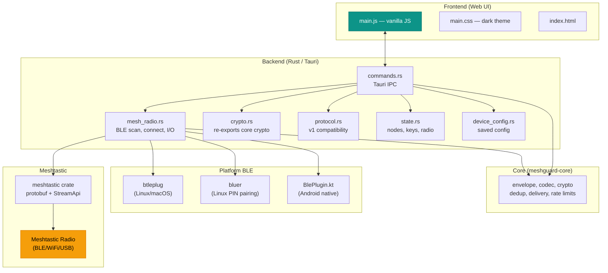

# MeshGuard — Secure P2P Mesh Messenger

[](https://github.com/nemke82/meshguard/releases/latest)
[](LICENSE)
[](https://apt.izzysoft.de/fdroid/index/apk/com.meshguard.app)

Privacy-first encrypted peer-to-peer messenger for [Meshtastic](https://meshtastic.org/) devices. No internet, no servers, no accounts. MeshGuard connects to your Meshtastic radio via Bluetooth, discovers other mesh nodes, and lets you start encrypted conversations using a shared passphrase — nothing secret ever travels over the air.



## Features

- **BLE device scanning** — discovers nearby Meshtastic devices (SenseCAP, T-Beam, Heltec, RAK, etc.)
- **PIN-based BLE pairing** — handles Bluetooth pairing with PIN entry (default `123456`)
- **Mesh node discovery** — sees all nodes on the mesh network in real time
- **Passphrase-based chat** — tap a node, enter a shared passphrase, start chatting
- **End-to-end encryption** — AES-256-GCM with deterministic key derivation (HKDF-SHA256)
- **No key exchange over the air** — both peers derive identical keys locally from the passphrase
- **MeshGuard 2.0 protocol** — every message carries a stable ID, timestamp and lifetime, and is bound to its sender and recipient
- **Delivery confirmations** — ✓ means queued for transmission, ✓✓ means the peer's app received and decrypted it (2.0 mode)
- **Duplicate and replay protection** (2.0 mode) — relayed copies are shown once, and a captured message cannot be replayed, even after a restart
- **Backward compatible** — turn off *MeshGuard 2.0 mode* to chat with peers on an older version
- **Remembers your chats and radio** — reconnects to the last radio on start and whenever it comes back (battery, range, reboot); on Android, paired chats open without re-entering the passphrase
- **Compact binary protocol** — messages fit within Meshtastic's ~228-byte LoRa payload limit, checked in bytes before sending
- **Notification sounds** — audible alert + popup toast for incoming messages, with custom sound support
- **Cross-platform** — Android, Linux (deb/rpm/AppImage), macOS
- **WiFi & USB serial** — connect to Meshtastic devices over TCP or serial, not just Bluetooth
- **Dark theme, mobile-first UI** — designed for field use

## Downloads

### Android

[](https://apt.izzysoft.de/fdroid/index/apk/com.meshguard.app)
&nbsp;&nbsp;
[](https://github.com/nemke82/meshguard/releases/latest/download/meshguard-android.apk)

Or grab the APK directly from the latest [**GitHub Release**](https://github.com/nemke82/meshguard/releases/latest). Requires Android 8.0 or newer.

### Desktop

| Platform | Download | Install |
|----------|----------|---------|
| Ubuntu / Debian | [`.deb`](https://github.com/nemke82/meshguard/releases/latest) | `sudo dpkg -i meshguard_*.deb` |
| RHEL / Fedora | [`.rpm`](https://github.com/nemke82/meshguard/releases/latest) | `sudo dnf install meshguard-*.rpm` |
| Linux (any) | [`.AppImage`](https://github.com/nemke82/meshguard/releases/latest) | `chmod +x meshguard-*.AppImage && ./meshguard-*.AppImage` |
| macOS (universal) | [`.dmg`](https://github.com/nemke82/meshguard/releases/latest) | Open the DMG, drag MeshGuard to Applications |

---

## Quick Start

### What You Need

- **2 Meshtastic devices** (SenseCAP T1000, T-Beam, Heltec, RAK, or any Meshtastic-compatible radio)
- **2 phones or computers** running MeshGuard
- Bluetooth enabled on both
- Both radios on the **same Meshtastic channel** and **same region frequency** (e.g., both EU868 or both US915)

### Step 1 — Scan & Connect

1. Open MeshGuard and tap **Scan for Devices**
2. Your Meshtastic radio will appear in the list — tap it
3. Enter the BLE pairing PIN (default `123456`) and tap Connect
4. MeshGuard connects, reads the device configuration, and loads the mesh node list

### Step 2 — Start a Secure Chat

1. On the **Mesh Network** screen, you'll see all discovered nodes
2. Tap the peer you want to chat with
3. Enter a **shared passphrase** that you and your peer agreed on beforehand (in person, phone call, etc.)
4. Leave **MeshGuard 2.0 mode** on if your peer also runs MeshGuard 2.0. Turn it off only to chat with an older version
5. MeshGuard derives an AES-256 encryption key from both device identities + passphrase
6. You're in — type and send encrypted messages

### Step 3 — On the Other Side

Your peer does the same: scans, connects to their radio, taps your node, enters the **same passphrase**. Both sides derive identical keys — no key exchange needed.

In MeshGuard 2.0 mode, a chat paired in 2.0 mode stays on 2.0: an old-format request from that peer is refused instead of silently downgrading the chat. To go back to the old format, remove the peer and pair again with 2.0 mode off.

---

## How It Works

### Connection Flow



### Message Exchange



### Wire Protocol

MeshGuard 2.0 frames fit in one LoRa packet (228-byte budget):

```
"MG2" | nonce (12) | AES-256-GCM( version | type | message_id (16) | created_at | ttl | body ) | tag (16)
```

- **Message ID** — 16 random bytes, the same on every relayed copy, used for duplicate detection and delivery ACKs
- **Freshness** — messages older than their lifetime, or too far in the future, are dropped
- **Direction binding** — sender and recipient are authenticated as associated data, so a frame cannot be reflected back to its sender
- **Max text** — the app limits messages to 173 bytes in both modes (the older format itself would allow 199). Multi-byte characters such as č, ш or emoji count as 2–4 bytes

The older format (`nonce | AES-GCM([type][UTF-8 text])`) is still read, so 2.0 can talk to earlier versions. The full specification is in [ADR-003](docs/adr/003-wire-protocol-v2.md).

### Key Derivation



### Double Encryption Layers



---

## Security Model

| Layer | Protection |
|-------|-----------|
| Message encryption | AES-256-GCM (authenticated, 256-bit key) |
| Key derivation | HKDF-SHA256 from sorted device identities + passphrase |
| Wire format | MeshGuard 2.0 envelope (ID, timestamp, TTL), encrypted once; older format still readable |
| Message integrity | AEAD bound to sender and recipient; no reflection, no silent protocol downgrade |
| Replay protection | 2.0 mode: freshness window + persistent duplicate cache (IDs and timestamps only, never content). The older format has no replay protection |
| Logging | Message contents are never written to logs |
| Key exchange | **None over the air** — keys derived locally from shared secret |
| Channel encryption | Meshtastic PSK (LoRa-layer encryption, device to device) |
| Memory safety | Written in Rust — no buffer overflows; keys zeroized on drop |
| Passphrase handling | Never saved to storage, never transmitted |
| Remembered chats | Android: derived chat keys sealed with a vault key held in the Android Keystore ([ADR-002](docs/adr/002-key-persistence.md)); desktop: memory only |
| Transport | LoRa mesh — no internet, no servers, no DNS |
| MQTT/uplink | Disabled — no data leaves the mesh |

---

## Architecture

Built with [Tauri 2.0](https://tauri.app/) — Rust backend + web frontend.



### Project Structure

```
meshguard/
├── crates/
│   └── meshguard-core/        # Platform-free core: v2 envelope, codec, crypto, dedup,
│                              # delivery state, rate limits, test vectors
├── docs/
│   ├── design/                # MeshGuard 2.0 design RFC
│   ├── adr/                   # Architecture decision records
│   └── audit/                 # Baseline audit
├── src-tauri/
│   ├── src/
│   │   ├── lib.rs             # Tauri app entry point
│   │   ├── main.rs            # Binary entry point
│   │   ├── mesh_radio.rs      # BLE scan, connect, polling stream, message I/O
│   │   ├── ble_plugin.rs      # Native Android BLE plugin (Kotlin bridge)
│   │   ├── crypto.rs          # Re-exports AES-256-GCM + HKDF from meshguard-core
│   │   ├── protocol.rs        # v1 wire format (compatibility)
│   │   ├── dedup_store.rs     # Persists the duplicate/replay cache
│   │   ├── commands.rs        # Tauri IPC commands (scan, connect, chat, pair)
│   │   ├── device_config.rs   # Saved device/peer configuration
│   │   ├── state.rs           # Shared app state (nodes, keys, radio)
│   │   └── error.rs           # Error types
│   ├── Cargo.toml
│   └── tauri.conf.json
├── ui/
│   ├── src/
│   │   ├── main.js            # UI logic: Connect → Mesh → Passphrase → Chat
│   │   └── styles/main.css    # Dark theme, mobile-first
│   ├── index.html
│   └── package.json
├── scripts/
│   └── patch-android.sh       # Patches Android build for BLE permissions + native plugin
└── .github/workflows/
    ├── ci.yml                 # Check + test + clippy on push/PR
    └── release.yml            # Build all platforms on tag push
```

### Platform-Specific BLE

| Platform | BLE Stack | Notes |
|----------|-----------|-------|
| Linux | `btleplug` + `bluer` | btleplug for GATT, bluer for PIN-based BlueZ pairing via D-Bus agent |
| macOS | `btleplug` | CoreBluetooth backend |
| Android | Native Kotlin plugin | Custom `BlePlugin.kt` injected via `patch-android.sh` — handles scan, GATT connect, bonding, read/write |

---

## Building from Source

### Prerequisites

- [Rust](https://rustup.rs/) (stable)
- [Node.js](https://nodejs.org/) 20+
- [Tauri CLI](https://tauri.app/) — `cargo install tauri-cli --version "^2"`

**Linux (Ubuntu/Debian):**
```bash
sudo apt install libwebkit2gtk-4.1-dev libappindicator3-dev librsvg2-dev \
  patchelf libdbus-1-dev pkg-config libssl-dev
```

**Linux (RHEL/Fedora):**
```bash
sudo dnf install gcc gcc-c++ webkit2gtk4.1-devel libappindicator-gtk3-devel \
  librsvg2-devel patchelf dbus-devel openssl-devel pkg-config rpm-build
```

**macOS:**
```bash
xcode-select --install
```

### Build & Run

```bash
cd ui && npm install && cd ..

# Desktop development
cargo tauri dev

# Desktop release
cargo tauri build

# Android
cargo tauri android init
bash scripts/patch-android.sh
cargo tauri android dev     # dev on connected device
cargo tauri android build   # release APK
```

### Creating a Release

Tag with a date version — CI builds all platforms automatically:
```bash
git tag v2026.11.14
git push origin v2026.11.14
```

Produces: Android APK, .deb, .rpm, .AppImage, macOS .dmg, plus SHA256 checksums, and an Android App Bundle (`.aab`) for Google Play as a workflow artifact.

The Android build requires the signing keystore secrets (`ANDROID_KEYSTORE_BASE64`, `ANDROID_KEYSTORE_PASSWORD`, `ANDROID_KEY_ALIAS`, `ANDROID_KEY_PASSWORD`). See [docs/release/google-play.md](docs/release/google-play.md) for creating the key and publishing on Google Play.

---

## Supported Devices

MeshGuard works with any Meshtastic-compatible radio, including:

- **SenseCAP T1000** / T1000-E
- **LilyGO T-Beam** / T-Beam Supreme
- **Heltec LoRa 32** / V3 / Wireless Tracker
- **RAK WisBlock** (RAK4631, RAK11200)
- **Station G2**
- Any device running Meshtastic firmware 2.x

---

## Troubleshooting

| Problem | Solution |
|---------|----------|
| No devices found on scan | Make sure Bluetooth is on, device is powered, and within ~10m range |
| PIN rejected | Default Meshtastic PIN is `123456`. Check your device's Bluetooth settings |
| Connection timeout | Try scanning again. On Linux, ensure `bluetoothd` is running |
| Messages not arriving | Both radios must be on the same channel + region. Re-enter passphrase on both sides |
| "No session" error | Passphrase hasn't been entered this session. Tap the peer and re-enter it |
| Peer runs an older MeshGuard | Turn off **MeshGuard 2.0 mode** when pairing, on both sides |
| "Paired in MeshGuard 2.0 mode" error | The peer sent an old-format request to a 2.0 chat. Remove the peer and pair again if you really want the older format |
| Message stays at ✓ | It was queued for transmission but no confirmation came back yet. The peer may be out of range or on an older version (no ✓✓ there) |
| "Message too long" | The message is over the byte limit — shorten it (the counter shows bytes left) |
| Short range | Use Long Range modem preset. Elevate devices. Use external antenna if available |

### Tips for Best Range

- **Elevation** — place Meshtastic radios as high as possible
- **Line of sight** — LoRa reaches 15+ km over water/flat terrain, 2–5 km in urban areas
- **External antenna** — dramatically improves range on supported devices
- **Long Range modem preset** — trades speed for maximum distance
- **Message length** — the counter shows remaining bytes (173 max); every message fits in a single packet

---

## Contributing

Pull requests welcome. Run checks before submitting:

```bash
(cd crates/meshguard-core && cargo fmt --check && cargo clippy --all-targets -- -D warnings && cargo test)
(cd src-tauri && cargo clippy -- -D warnings && cargo test)
```

Design notes: [MeshGuard 2.0 RFC](docs/design/MESHGUARD_2_0_DESIGN_RFC.md) · [ADRs](docs/adr/README.md)

## License

MIT
