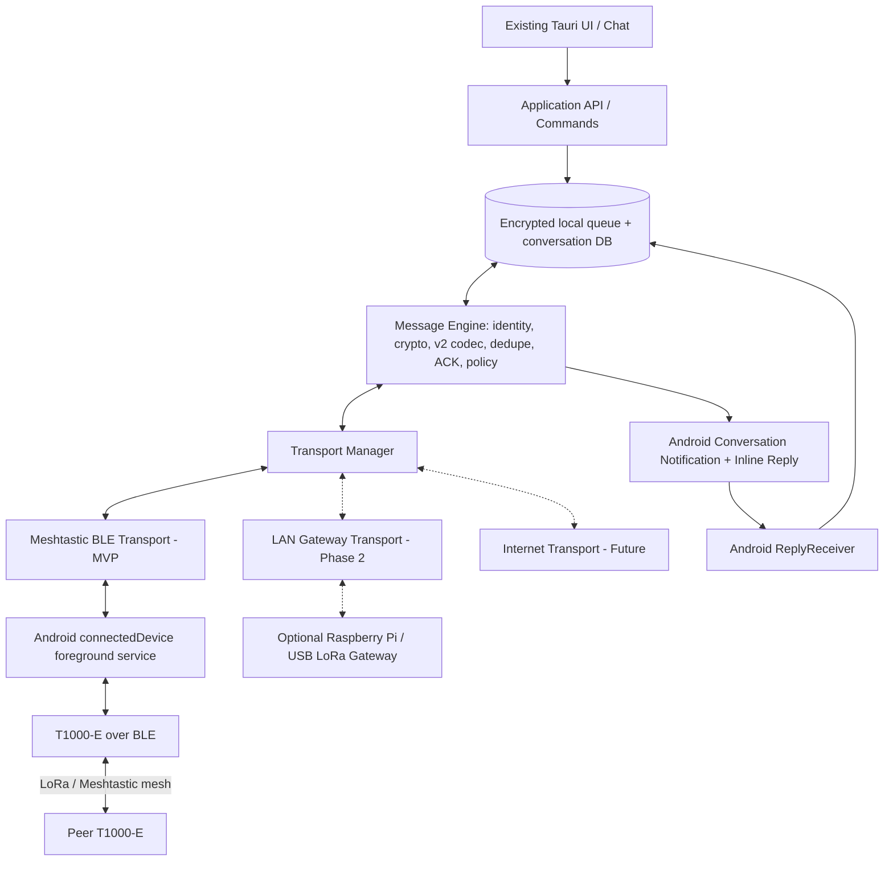
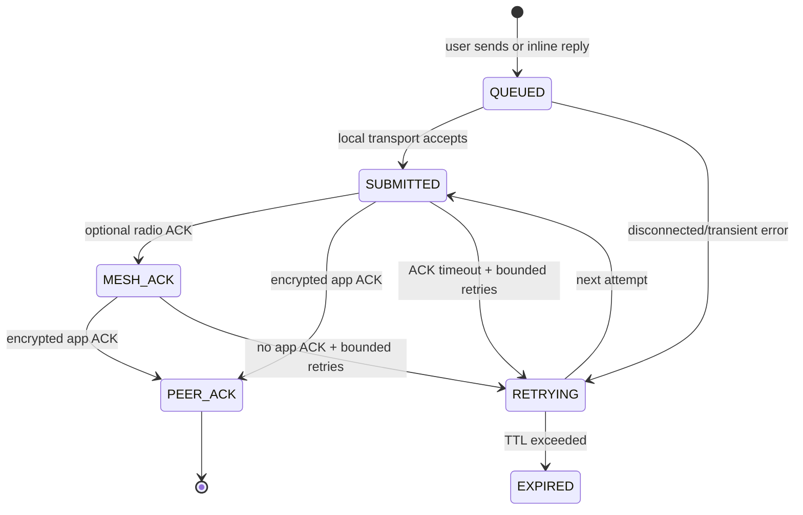

# MeshGuard 2.0 — Offline-First, Transport-Agnostic Android Messenger

**Status:** Proposed RFC (implementation guide, not an assertion of finished features)  
**Date:** 2026-11-14  
**Repository:** https://github.com/nemke82/meshguard  
**Audience:** Owner, Codex coding agent, Android/Rust contributors  
**Primary release target:** Android with **two existing Seeed SenseCAP T1000-E Meshtastic devices**, one paired to each Android phone; **no Raspberry Pi or new radio equipment required for Phase 1**.  
**Later expansion:** Raspberry Pi 4 + XIAO ESP32S3 / Wio-SX1262 over USB + home Wi-Fi, roof antenna, eventually optional Internet and AIOC/UV-5R integrations.

> Product definition: MeshGuard is not merely a chat screen. It is an **offline-first communications engine**, with a native Android background connection and conversation notifications. A person sends a message to a person; MeshGuard chooses an available delivery transport, maintains durable state, and lets the recipient reply directly from an Android notification without opening the UI.

## 0. Decisions already made

1. **Keep and refactor the existing MeshGuard project**: Rust + Tauri 2 + web UI; do not rebuild a new product from scratch.
2. **No SMS integration in MVP**. Do not request `READ_SMS`, `WRITE_SMS`, `RECEIVE_SMS`, default-SMS-app role, or Google Messages database access. The user wants ordinary **Android conversation notifications with inline Reply**.
3. **First hardware test uses two existing T1000-E radios**. Pair one T1000-E with Phone A and the other with Phone B via BLE; radios communicate over Meshtastic LoRa (directly or through compatible mesh relays).
4. **No cloud/server is required for BLE-to-LoRa messaging**, and Android conversations work without cellular service if the BLE/LoRa link works.
5. **A second phase will add a gateway** on Raspberry Pi 4; it is an optional transport node, not a required centralized message server or trust authority.
6. **PTT, SMS relay, AIOC, UV-5R, voice, GPS/SOS automation and dynamic internet failover are *not* MVP requirements**. Preserve architecture seams for them, without making premature promises.
7. **Do not assume 24/7 guaranteed Android execution.** Foreground-service limitations, BLE radio sleep, OEM battery management, permissions, and distance still apply.
8. Treat this RFC as **design intent**. Where an implementation detail is unknown, Codex must inspect the repository and validate platform APIs before coding.

## 1. Repository-grounded baseline (2026-11-14)

The existing public repository describes:

- `src-tauri/` Rust/Tauri 2 backend; `ui/` web UI; Android platform bridge patched by `scripts/patch-android.sh`.
- `src-tauri/src/mesh_radio.rs`: Meshtastic BLE/TCP/serial connectivity and packet handling.
- `src-tauri/src/ble_plugin.rs` and generated Kotlin `BlePlugin`: Android BLE interoperability.
- `src-tauri/src/crypto.rs`: AES-256-GCM and passphrase-based key derivation.
- `src-tauri/src/protocol.rs`: app-specific encrypted `PortNum::PrivateApp` messages (256).
- `src-tauri/src/commands.rs`, `state.rs`, `device_config.rs`: Tauri commands, session and device state.
- `scripts/patch-android.sh`: currently inserts native Kotlin BLE implementation and basic notifications into generated Android project.
- `CLAUDE.md`: a compact project map; build commands and v1 wire format.

**Verified issues motivating v2:**

- `protocol.rs` generates local UUIDs, but its `to_wire()` serializes only message type and payload; `from_wire()` generates a **new UUID on receipt**. Thus the wire protocol has no stable end-to-end message identity. This breaks reliable deduplication, app-level receipts and multi-transport delivery.
- `state.rs` stores peer session keys **only in process memory**. Background receipt after process death or phone restart requires an explicit key-persistence/unlock strategy.
- `scripts/patch-android.sh`'s `showNotification()` constructs a basic `Notification.Builder` alert with a launch intent; it is **not** an Android `MessagingStyle` conversation with direct `RemoteInput` reply.
- Current Tauri command/UI boundaries must be audited: a Kotlin Android `Service` must not depend on a WebView being open in order to receive, decrypt, persist and notify.

Do not assume this is a full security audit or exhaustive code review. Codex must verify the checkout and annotate deviations.

## 2. Target user experience

### Primary story

1. A user installs MeshGuard, permits notifications and Bluetooth, pairs their T1000-E and explicitly enables background connection.
2. App A and App B are installed on two Android phones and each is connected to its own T1000-E.
3. User A sends an encrypted message to User B. Their phone can be locked and MeshGuard's chat screen closed.
4. The radio network delivers the encrypted packet to T1000 B; Android's native connection service receives it, verifies/decrypts it, saves it and publishes an Android **Conversation** notification.
5. B taps the inline **Reply** action, enters text in the notification shade, and sends **without launching the MeshGuard UI**.
6. If B's radio is temporarily unavailable, the reply is saved to an outbox and queued, not silently discarded. The UI/notification makes its status clear.
7. In the app, both see one durable conversation with no duplicate bubbles, even when the same packet is relayed repeatedly.

### Visual behavior

- Separate **persistent connection/service** notification (low importance) from **actual conversation** notifications.
- Conversation notification uses `NotificationCompat.MessagingStyle`, `Person`, stable conversation shortcut, `NotificationCompat.Action` + `RemoteInput`.
- One notification per thread; update same notification rather than flooding.
- Native sender/peer display name and last few messages; lockscreen privacy setting defaults to **hide message body**.
- Inline Reply must enqueue first, then report `Queued`/`Sending`/`Delivered` appropriately; never claim delivered merely because Android accepted text.
- Tapping the notification opens the correct conversation in existing Tauri UI, not a generic landing page.
- Optional Android bubbles, wearables and smart replies are later enhancements.

### Truthful status vocabulary

| Status | Exact meaning | May UI call it 'delivered'? |
|---|---|---|
| `DRAFT` | Created but not queued | No |
| `QUEUED` | Persisted locally awaiting transport | No |
| `SUBMITTED` | Accepted by local BLE/radio/gateway transport | No |
| `MESH_ACK` | Meshtastic-side acknowledgement, if available | **No** — not recipient app confirmation |
| `PEER_ACK` | Authenticated MeshGuard ACK from intended recipient app | **Yes** |
| `READ` | Explicit optional user read receipt | Yes, separate from delivered |
| `RETRYING` | Will retry under bounded policy | No |
| `FAILED` / `EXPIRED` | Cannot deliver / TTL exceeded | No |

No guarantee of delivery when the mesh is partitioned, receiver is unavailable, or hop budget exhausted. LoRa mesh relaying is performed by Meshtastic firmware; our app should not implement a second indiscriminate flooding layer.

## 3. Architecture and responsibility boundaries



### Layer contracts

**Core domain (portable Rust preferred)**

- `EnvelopeV2` serialization, encryption/decryption, authentication, stable message IDs, deduplication keys, expiry, ACK policy, retry backoff, message state machine.
- Pure logic with unit/property/fuzz-style tests independent of Android/Tauri/BLE.
- Expose explicit functions to Android native layer through a **documented, tested boundary** (prefer reusing Rust core via JNI/UniFFI/ffi bindings if feasible). **Do not implement two incompatible crypto/protocol stacks** in Rust and Kotlin.

**Android runtime (native Kotlin)**

- Sole owner of Android `BluetoothGatt` connection and subscription while foreground/background service is active.
- `MeshGuardConnectionService` started through explicit user action and type `connectedDevice` (validate runtime and manifest requirements).
- Foreground notification, reconnection/state transitions, BLE permissions, Android battery/OEM guidance, CompanionDeviceManager evaluation.
- Native `BroadcastReceiver` for direct reply, service-safe message injection, Android Conversation notification posting.
- No dependence on a mounted WebView. Tauri UI is a client of engine state.

**Persistent store**

- Conversation metadata, message envelope ciphertext, outbound retries, dedup cache, transport attempts, peers, permissions and optional encrypted key material.
- SQLite on Android (Room if Kotlin owns persistence, or Rust `rusqlite`/SQLCipher if the engine owns storage). Select **one canonical store** and enforce ownership boundaries.
- Avoid storing plaintext unless explicitly chosen; define database encryption & backup policy before persisting decryption keys.

**Transport adapter contract**

```text
interface Transport {
  id() -> TransportId
  capabilities() -> {can_send, can_receive, mtu, cost, metered, supports_ack}
  health() -> {ready, degraded, disconnected, reason}
  send(peer, encrypted_frame, metadata) -> SubmissionResult
  subscribe(on_encrypted_frame, on_link_status)
  start()/stop()
}
```

The adapter transports **opaque encrypted frames**. It does not own user identity, message IDs, UI text, application ACK or permanent message history. Preserve `TransportId` with each attempt for diagnostics. `send()` succeeding is only a *submission* event, not recipient delivery.

### Critical Android/Rust integration decision (ADR-001)

The current app relies on a generated Kotlin BLE plugin injected via `scripts/patch-android.sh`. It may be tempting to create a background Kotlin service that merely forwards events into Tauri. **That fails if the WebView/Tauri process lifecycle cannot sustain the handler.**

Before implementation Codex must investigate one of:

- **Preferred if practical:** extract portable Rust `meshguard-core` library + an Android service that invokes its stable FFI API for encrypt/decrypt, persistence and outbox. Keep BLE native Kotlin; Tauri frontend also calls shared core.
- **Alternative prototype:** native Android service owns BLE, encrypted packet queue and Android notifications, and uses a separately initialized Rust-native core API. It must function without Tauri web UI and avoid duplicated key derivation.

**Gate:** prove that a real packet can be processed and an inline reply enqueued after swiping away the activity, without an active Tauri WebView. Do not continue to features until this is demonstrated.

## 4. Wire protocol v2 and backward compatibility

### Why v2 is needed

V1 sends `[type][UTF-8 data]` under app AES-256-GCM and does not send its local UUID or timestamp. Consequently the receiver cannot deduplicate independently of transport-specific packet IDs. A v2 envelope is required, but do not break existing v1 communication in one uncontrolled change.

### Proposed *logical* envelope fields

```text
MeshGuardEnvelopeV2 {
  protocol_version = 2
  message_type = TEXT | APP_ACK | ...
  message_id = 16 random bytes (stable end-to-end)
  conversation_id = stable local logical peer/conversation identifier
  created_at = unix seconds
  expires_at = unix seconds / limited TTL
  sender_identity = stable authenticated identity (design pending)
  recipient_identity = stable authenticated identity (design pending)
  encrypted_body = compact UTF-8 text / ACK id
}
```

This is a **logical model**, not a license to place all fields as strings in LoRa payloads. Design a compact binary format and move values already guaranteed by the Meshtastic transport into authenticated context where safe. A reasonable starting concept (subject to size, interoperability and threat review):

```text
outer: ASCII 'MG2' (3B) | AEAD nonce | AEAD ciphertext+tag
inner encrypted bytes: version(1) | type(1) | msg_id(16)
                     | created_at(4) | expires_delta(2)
                     | body_len(varint) | body(...)
```

- Bind version/header and any security-relevant routing identity with AEAD associated data; validate this carefully to support future non-LoRa transports.
- Require CSPRNG nonces and IDs, authenticated encryption, bounds checks and replay resistance; never reuse AES-GCM `(key,nonce)` pairs.
- Budget to actual `PortNum::PrivateApp` capacity on current Meshtastic firmware — including AEAD overhead and protobuf/transport frame limits. **Do not assume any fixed maximum of 228 or 200 bytes without verification.** Reject or offer text shortening in MVP; no unbounded automatic fragmentation.
- Frame bytes are encrypted independently of transport. Use identical `message_id` when retrying on a different transport, while using fresh nonce if re-encrypting.
- Deduplicate by `(authenticated sender identity, message_id)`; ACK duplicates without producing duplicate notifications. Store bounded dedup entries through restarts.
- V1/v2 dual-read during transition. Use an unambiguous version discriminator and backward-compatibility tests; distinguish `Unsupported`, `Locked`, `AuthFailed`, and `Malformed` without exposing private plaintext.
- Avoid uncontrolled ACK-of-ACK loops. Limit app ACK retries and air time. Do not confuse Meshtastic packet acknowledgements with `APP_ACK`.
- **Identity ADR required:** Current key derivation uses device *names*. Renames and multiple transports make names unsuitable as permanent cryptographic identities. Introduce stable app peer identity and migration path; do not silently change v1 derivation and strand users.

### Protocol tests

- v2 encode/decode known-answer vectors and byte budgets.
- v1 legacy decode must remain valid; ambiguous marker rejection.
- Dedup across repeated LoRa packets / simulated two transports.
- Cross-platform Rust <-> Android FFI interoperability vectors.
- Tampered ciphertext, truncated packet, oversized message, clock skew, expired replay, wrong key, changed sender identity.
- Compact ACK, no ACK loop, peer-ACK drives `PEER_ACK` only on authenticated receipt.

## 5. Crypto and key persistence policy (ADR-002)

Current repo describes AES-256-GCM, HKDF-SHA256 from sorted peer device names and shared passphrase; session keys are memory-only. This needs an explicit transition plan rather than assuming the current phrase is already a durable identity.

1. **Default privacy-first mode:** if key unavailable, persist **ciphertext only**, notify 'Encrypted message received — unlock MeshGuard', and do not display or log plaintext. Still show that a new message exists.
2. **Opt-in background unlock:** a user may opt to protect persistent session material with Android Keystore-backed encryption to allow unlocked-device background decryption and inline reply. Document the exact device-lock/unlock/reboot behavior for the chosen Keystore keys; test it on target Android versions. Never store the passphrase in plaintext.
3. Consider a stronger passphrase-to-key KDF (e.g. parameterized Argon2id) or high-entropy QR/shared key invitation for v2, because HKDF alone does not slow **offline guesses against weak user passphrases**. Do not break v1 pairings without migration.
4. Exclude decrypted bodies, raw keys, passphrases, exact location, and sensitive peer names from logs/crash analytics. Redact traces and support log export.
5. Gate decryption, notification previews and any `Reply` action on access to the correct unlocked key; locked state must be explicit, not silent failure.
6. Treat Meshtastic channel PSK and MeshGuard end-to-end encryption as separate layers. Public channels and relays can forward packets, but should not be assumed to provide confidentiality themselves.
7. Threat model later: compromised phone, malicious relay, wrong/renamed node, stolen unlocked phone, duplicate/replayed radio packet, hostile gateway, stale key, wrong-app intents.

## 6. Android details (MVP)

### Core components (suggested names, not prescribed final files)

```text
android/...
  MeshGuardConnectionService.kt   // BLE ownership + state/reconnect
  MeshtasticBleClient.kt          // reusable Android GATT implementation
  MeshGuardReplyReceiver.kt       // explicit receiver for RemoteInput
  ConversationNotifier.kt        // MessagingStyle + stable shortcut
  NotificationChannels.kt        // channels + lockscreen policy
  DeviceAssociationHelper.kt     // optional CompanionDeviceManager
  AndroidCoreBridge.kt           // secure Rust core FFI boundary
```

**Do not put these exclusively inside a generated directory** that is overwritten on `cargo tauri android init`; migrate generated code into a maintainable location / plugin and keep the build patch idempotent.

### Permission and lifecycle checklist

- `BLUETOOTH_CONNECT`, `BLUETOOTH_SCAN` with modern permission flows; pre-Android-12 requirements as dictated by minSdk.
- `POST_NOTIFICATIONS` on Android 13+; handle denial gracefully (messaging may continue with restricted UI visibility).
- `FOREGROUND_SERVICE`, `FOREGROUND_SERVICE_CONNECTED_DEVICE`, service `android:foregroundServiceType="connectedDevice"` where required; verify real prerequisites before calling `startForeground()`.
- Start connection service **from a user-visible action**, not from arbitrary background context. Observe Android 12+ background-start restrictions and Android 14+ FGS checks; consider Android 15/16 updates.
- Evaluate `CompanionDeviceManager`/device-presence and companion-device services for legitimate sustained device communication; don't assume unrestricted auto-start at boot.
- Android's persistent service notification is not a message notification. Use separate channels (e.g., `meshguard_connection`, `meshguard_conversations`, `meshguard_alerts`).
- Publish long-lived conversation shortcuts, `Person`, `NotificationCompat.MessagingStyle` and `setShortcutId`; use stable conversation ID (not mutable BLE name).
- Add action `Reply` via `RemoteInput` and **explicit** `PendingIntent.getBroadcast` with correct mutability on modern Android, safe unique request codes/data URIs, `FLAG_UPDATE_CURRENT`, and an unexported/internal receiver. Validate caller/conversation, length and auth status.
- For inline Reply, persist text to outbox **before** BLE attempt, then notify state, even if device disconnects.
- Handle multiple conversations, update-notification grouping, lockscreen content visibility, DND behavior, notification permission changes, and process restart.
- Use backoff with jitter for BLE reconnect; cap attempts and radio writes, respect device battery.
- Keep connection state visible: `Connected`, `Reconnecting`, `Offline`, `Bluetooth permission needed`, `Radio unavailable`, `Locked`.

### Scope and limitations

- Background behavior is **best effort**, not guaranteed if user force-stops app, revokes permissions, device is out of BLE range, radio is sleeping, OEM aggressively kills services, or system prevents a service restart.
- Test both a normal backgrounded app and a manually **force-stopped** app; do not imply identical behavior.
- Avoid making `BOOT_COMPLETED` a magical promise of always-on BLE; identify allowed startup paths per OS version.
- Receiver screen can display conversation notifications while locked, but decryption/inline Reply capabilities depend on key-unlock policy.

## 7. Durable outbox, retries, deduplication

### Minimal schema (conceptual)

```sql
CREATE TABLE conversations (
    conversation_id TEXT PRIMARY KEY,
    peer_identity TEXT NOT NULL,
    display_name TEXT,
    last_message_at INTEGER,
    unread_count INTEGER DEFAULT 0
);
CREATE TABLE messages (
    message_id BLOB NOT NULL,
    conversation_id TEXT NOT NULL,
    direction TEXT NOT NULL CHECK(direction IN ('in','out')),
    encrypted_payload BLOB NOT NULL,
    created_at INTEGER NOT NULL,
    expires_at INTEGER,
    status TEXT NOT NULL,
    transport_id TEXT,
    PRIMARY KEY(message_id, direction)
);
CREATE TABLE outbox (
    message_id BLOB PRIMARY KEY,
    attempts INTEGER NOT NULL DEFAULT 0,
    next_attempt_at INTEGER NOT NULL,
    last_error TEXT
);
CREATE TABLE received_ids (
    sender_identity TEXT NOT NULL,
    message_id BLOB NOT NULL,
    seen_at INTEGER NOT NULL,
    PRIMARY KEY(sender_identity,message_id)
);
```

This is a **starting model**, not final SQL migration. If storing ciphertext in a DB and AES-GCM nonces elsewhere, design correct key ownership and database encryption. Peer identity and message id may require schema adjustments. Don't persist plaintext in `messages` unless security design explicitly approves it.

### Outbound state flow



- Avoid retry storm, particularly on shared public LoRa mesh. Exponential backoff + jitter, TTL, max_attempts, transport-specific airtime limits.
- For phases with only one transport, use one adapter and still preserve the state model.
- A reply from notification is **not** lost just because the initial BLE send fails.
- Replay/dedup state must survive process restart.

## 8. Phased implementation backlog for Codex

### P0 — Audit and preservation (no behavior change)

**Goal:** make refactoring safe and identify Android/runtime limitations.  
**Tasks:**

- Record Git commit, build/test instructions, current targets/minSdk/targetSdk, existing Tauri Android plugin structure, dependency versions.
- Run/check existing Rust test suite, `cargo fmt`, `cargo clippy`, Tauri desktop checks, Android build if environment supports them.
- Map BLE connection/callback ownership, runtime state, notification pipeline and access to Rust crypto when WebView is gone.
- Write `docs/adr/001-android-engine-boundary.md` comparing FFI approaches and picking one based on actual build feasibility.
- Create a short v1 compatibility fixture from existing `protocol.rs` tests.
- No broad UI rewrite. Maintain desktop behavior.

**Definition of Done:** documented existing architecture and baseline green tests, with any blocked checks identified.

### P1 — Domain extraction + v2 protocol (hardware not required)

**Goal:** durable message identity and clean interfaces.  
**Tasks:**

- Define `MessageId`, `ConversationId`, `PeerIdentity`, `EncryptedFrame`, `TransportId`, `DeliveryState`.
- Design compact v2 encrypted envelope and v1 dual-reader.
- Implement codec unit tests, compatibility fixtures, bounds/negative tests.
- Add `Transport` trait and `MockTransport`; do not touch live BLE behavior until tests pass.
- Add deterministic virtual-time retry/ACK/dedup tests.
- Choose key persistence ADR, provide locked state and no-plaintext preview behavior.

**Definition of Done:** offline test suite proves stable IDs, dedup and v1 interop; no device required.

### P2 — Android native service + notifications (mock transport first)

**Goal:** message UI without launching the activity.  
**Tasks:**

- Extract/restructure Kotlin BLE plugin code from generated patch into a stable module.
- Implement service ownership and reconnect lifecycle, with mock packet injection for UI testing.
- Implement three channels, shortcuts, `MessagingStyle`, explicit `RemoteInput` receiver.
- Persist notification replies to outbox atomically; update notification state.
- Verify close activity, screen off, app process reclaimed, permission revoked/regranted, locked keys.

**Definition of Done:** synthetic incoming frame raises a conversation notification; user replies without opening MeshGuard; reply is durably queued and appears once in conversation when UI is opened.

### P3 — Two-T1000 real radio MVP

**Goal:** actual offline text chat on two Android phones and two SenseCAP T1000-E devices.  
**Tasks:**

- Pair Phone A -> T1000 A; Phone B -> T1000 B. Use one active controlling BLE client per radio during test.
- Confirm both `EU_868`, same compatible Meshtastic channel/PSK/modem preset, and device/role behavior.
- Send private app v2 text through official Meshtastic APIs and decode on receiver.
- Validate notification, inline reply, app ACK, retry/duplicate suppression, link-loss recovery.
- Test physical LoRa range separately: first a few meters, then out of BLE range between radios but each phone near its own radio, then field test if desired.
- Measure logs and statuses without leaking plaintext, keys or location.

**Definition of Done:** reliable test script passes on two real phones + two T1000s **with app UI closed/backgrounded**, including an inline Reply on Phone B; failures truthfully show `queued`/`offline` rather than `delivered`.

### P4 — Raspberry Pi gateway (after shipment)

**Goal:** phone connects over home Wi-Fi to a Pi LoRa gateway, eliminating need for phone to stay within BLE range of rooftop radio.  
**Tasks:**

- Pi 4 + XIAO ESP32S3 / Wio-SX1262 + Meshtastic firmware via USB; gateway process uses Meshtastic serial API.
- LAN transport adapter with device discovery/pairing (or manually configured hostname), TLS/auth, ACL and replay/dedup.
- Gateway receives/transmits **opaque encrypted MeshGuard frames**; do not turn it into a plaintext key escrow or central identity provider.
- Durable gateway queue and TTL, fair access when multiple phones/users connect.
- Do not expose unauthenticated HTTP/WebSocket endpoints or open inbound internet ports by default.
- Evaluate whether a single Meshtastic radio can simultaneously serve both a serial gateway and other APIs without conflicts.
- Run BLE and LAN transport through same message engine and reuse message IDs.

**Definition of Done:** Phone B receives on its local LAN using a Wi-Fi-to-Pi gateway, including with Internet disconnected; gateway stores encrypted messages when phone offline and syncs later.

### P5 — Transport selection & resilience

**Goal:** transparently choose paths, without accidental duplicate messages or message leaks.  
**Tasks:**

- Route policy: connected healthy LAN gateway vs direct BLE T1000 vs explicitly configured internet transport; consult peer reachability and transport capabilities.
- No automatic plaintext SMS fallback; no unauthenticated public endpoint.
- Cross-transport idempotence, outbox replay, policy overrides and observability.
- SOS and PTT as separate future RFCs with explicit safety, bandwidth and regulatory requirements.

**Definition of Done:** simulated path failover retains same logical ID, exactly one visible incoming message, accurate ACK and audit history.

## 9. Two-T1000 acceptance test script

**Preconditions:** two Android phones, two SenseCAP T1000-E units with compatible Meshtastic firmware and adequate battery, working BLE pairing, matching radio region/preset/channel and correctly provisioned MeshGuard peer keys. You do **not** need a Pi for these tests.

| ID | Action | Expected |
|---|---|---|
| T01 | Phone A sends to Phone B; B on home screen | Conversation notification appears; sender and content follow privacy setting |
| T02 | B replies via inline Reply | Reply queued & transmitted with no MeshGuard UI launch |
| T03 | A is locked (but connected and key policy permits) | Native background service handles receipt; meaningful notification |
| T04 | Same encrypted frame arrives twice | Only one message/notification; duplicate can receive safe ACK |
| T05 | Disable Bluetooth before replying | Reply survives in `QUEUED`; reconnect eventually attempts send |
| T06 | Kill app activity; service permitted to remain | BLE and notification path do not depend on WebView |
| T07 | Android OS reclaims process | Queue persists; restoration according to allowed service lifecycle; no false guarantee |
| T08 | User force-stops app | Document expected lack of background operation until user reopens |
| T09 | Wrong key / locked store | No plaintext leak; message `Locked` or `AuthFailed` safely |
| T10 | Corrupt/expired/replayed frame | Rejected or deduplicated; no crash; no replay alert flood |
| T11 | Large UTF-8/multibyte message | Validated against actual packet size, clear error if oversize |
| T12 | Revoked BLE or notification permission | Graceful status and recovery instructions; no crash |
| T13 | Meshtastic app also connects to same device | Detect/handle connection contention without silent failure |
| T14 | Private conversation on shared public mesh | App-layer encryption persists; no private plaintext in diagnostic logs |
| T15 | Reboot phone and radio | Defined startup/unlock behavior, no loss of queued ciphertext |

**Measure:** packet counts, BLE disconnect/reconnect causes, notification presentation latency from received packet, ACK rate, duplicate rate, battery impact, process liveness and clear offline states. Do **not** promise a minimum long-distance radio range based on tabletop tests.

## 10. Repo changes proposed (not yet committed)

```text
meshguard/
├── docs/
│   ├── design/MESHGUARD_2_0_DESIGN_RFC.md
│   └── adr/
│       ├── 001-android-engine-boundary.md
│       ├── 002-key-persistence.md
│       └── 003-wire-protocol-v2.md
├── src-tauri/
│   └── src/                 # existing Rust modules, refactored incrementally
├── [core-crate-if-ADR-selects-it]/
│   └── src/{envelope,identity,delivery,transport}.rs
├── [maintained-android-plugin]/
│   └── ...                 # Kotlin service + BLE + notifications
├── ui/                     # existing UI, only minimal hooks initially
└── tests/                  # protocol and mock transport fixtures
```

**Names in square brackets are placeholders**: Codex should inspect real Tauri conventions and select correct paths rather than blindly creating arbitrary directories.

## 11. Non-goals, risks, and open decisions

**Non-goals for first release:** SMS app replacement, SMS bridge, microphone/PTT, audio over LoRa, universal Android notification interception, always-on operation after user force-stop, unrestricted public mesh capacity, automatic emergency-service integration, mandatory cloud accounts, battery-heavy continuous scanning when user has opted out.

**High-priority open ADRs:**

1. Shared Rust engine from Android `Service` without Tauri WebView — JNI/UniFFI/runtime and lifecycle proof.
2. Keystore storage and unlock behavior: security vs unattended decryption. Consent required.
3. Stable peer identity, identity verification, old `device name`-based KDF migration and version negotiation.
4. Actual safe v2 private-app packet byte budget; app ACK strategy and duty-cycle implications.
5. Durable DB ownership across Android and desktop app; backups and database schema migration.
6. Current T1000-E firmware BLE wake/sleep characteristics and battery expectations.
7. CompanionDeviceManager applicability versus normal `connectedDevice` service and target Android policy changes.

**Regulatory/operational:** Meshtastic's applicable region, RF emission limits and antenna gain restrictions must be configured lawfully. LoRa mesh/text is not a reliable substitute for emergency calling. Future amateur VHF/UHF packet/PTT features require separate licensing/authorization review.

## 12. References (inspect before implementation)

**Existing project:**
- https://github.com/nemke82/meshguard
- https://github.com/nemke82/meshguard/blob/main/CLAUDE.md
- https://github.com/nemke82/meshguard/blob/main/src-tauri/src/protocol.rs
- https://github.com/nemke82/meshguard/blob/main/src-tauri/src/state.rs
- https://github.com/nemke82/meshguard/blob/main/src-tauri/src/crypto.rs
- https://github.com/nemke82/meshguard/blob/main/src-tauri/src/commands.rs
- https://github.com/nemke82/meshguard/blob/main/scripts/patch-android.sh

**Android:**
- https://developer.android.com/develop/ui/views/notifications/conversations
- https://developer.android.com/social-and-messaging/guides/communication/notifications-conversations
- https://developer.android.com/develop/background-work/services/fgs/service-types
- https://developer.android.com/develop/background-work/services/fgs/restrictions-bg-start

**Meshtastic:**
- https://meshtastic.org/docs/configuration/radio/bluetooth/
- https://meshtastic.org/docs/configuration/radio/device/
- https://meshtastic.org/docs/configuration/radio/

---

**North star:** *No mandatory Internet. No mandatory central server. No mandatory app open on screen. Exactly one conversation and an honest delivery state, regardless of how the encrypted message reaches the device.*
